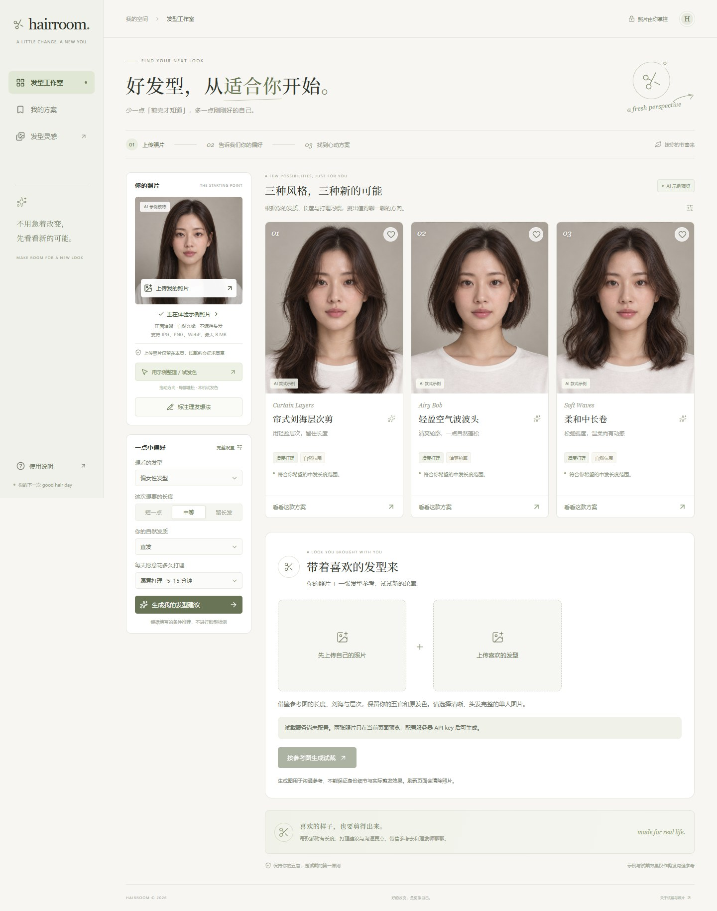
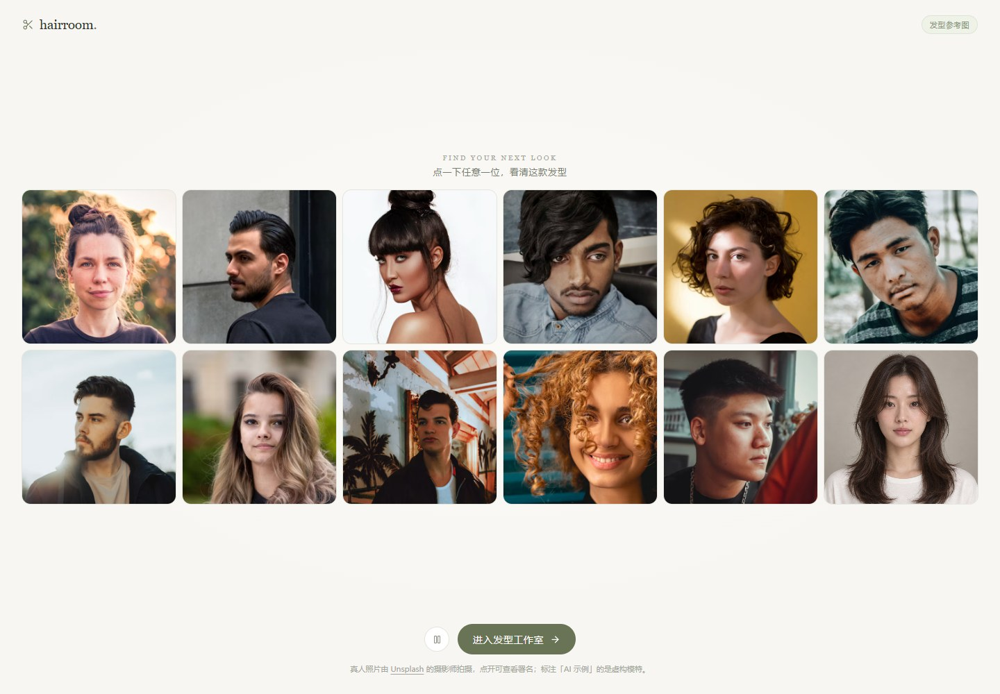
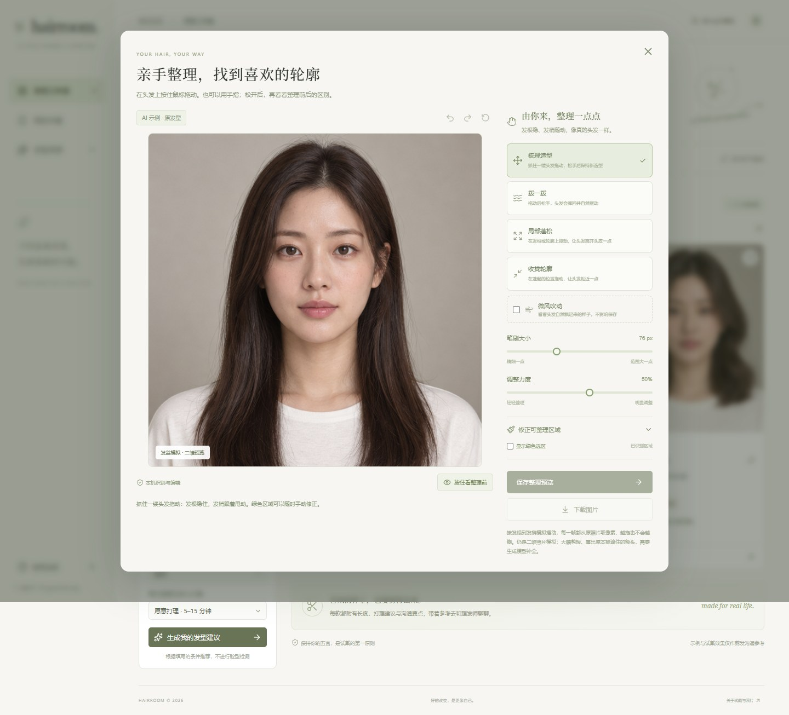
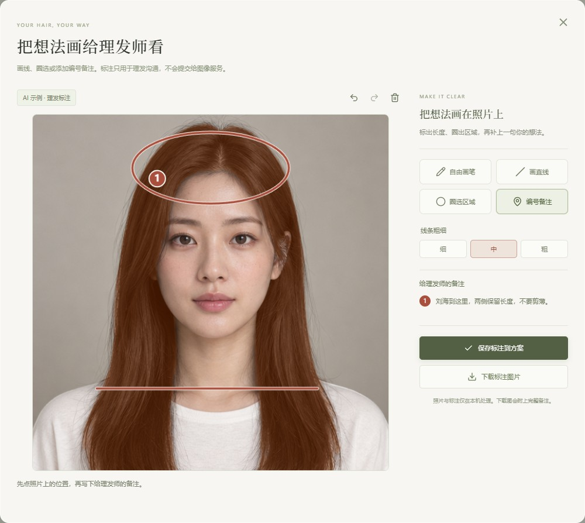
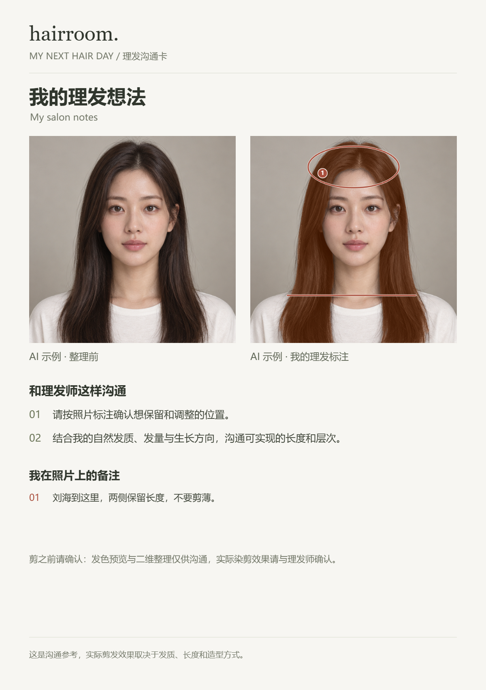
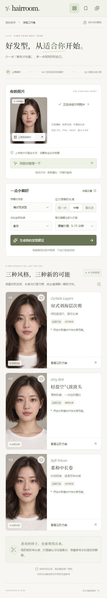

<div align="center">
  

  <h1>Hairroom</h1>

  <p><strong>剪发前，先看见自己。</strong><br />See your next look before the haircut.</p>

  <p>鼠标整理头发 · 本机发色预览 · 图片标注与沟通卡 · 可选参考图 AI 试戴<br />Interactive hair editing · Local color previews · Annotated salon cards · Optional reference-image AI try-on</p>

  <p>发色与标注在本机完成 · AI 试戴需自行配置 API key<br />Color and annotation tools run locally · Bring your own API key for AI try-on</p>

  <p>React 19 · Node.js 24 · MediaPipe · WebGL2 · Optional local AI fill</p>

  <p><a href="#中文">中文</a> · <a href="#english">English</a> · <a href="#快速开始">快速开始</a> · <a href="docs/technical-guide.zh-CN.md">技术与 API</a></p>

  
</div>

<p align="center"><em>截图中的工作室人像为虚构 AI 示例，不是用户照片或真实试戴结果。<br />Studio portraits are fictional AI examples, not user photos or personalized try-on results.</em></p>

<details>
<summary>查看更多界面 / More screenshots</summary>

### 发型灵感墙 / Hairstyle gallery



真人参考图来自 Unsplash，点击图片可查看摄影师署名与来源；AI 图片在应用中单独标注。[照片目录与署名](src/lib/hair-looks.js)。

Real reference photos come from Unsplash, with photographer credits and source links in the app. AI examples are labelled separately. [Photo catalogue and attribution](src/lib/hair-looks.js).

### 鼠标整理头发 / Interactive hair editor



### 发色与理发标注 / Hair color and salon annotations





### 手机端 / Mobile studio



[截图与素材说明 / Screenshot provenance](docs/assets/README.md)

</details>

## 中文

Hairroom 是一个本地运行的发型探索与理发沟通工作室。你可以浏览发型灵感，根据长度、发质和打理习惯比较方案，在自己的照片或虚构示例上用鼠标调整头发轮廓、预览新发色，再画线、圈选并写下备注，导出一张给理发师看的沟通卡。

想参考某张喜欢的发型图？上传本人照片与目标参考图，配置自己的图像 API key 后，可主动授权生成个人试戴。发色预览、图片标注与沟通卡导出均可在本机使用，无需图像 API key。

界面以暖白、鼠尾草绿和杂志式排版为主，支持桌面和手机浏览。当前应用界面为中文；本页提供中英文介绍。

### 可以做什么

| 功能 | 体验 |
| --- | --- |
| 发型灵感墙 | 12 格动态照片墙，男女发型交替展示，点击放大、左右浏览，部分款式可直接进入工作室 |
| 偏好建议 | 根据长度、发质、发量、打理时间和目标，用可解释的本地规则排序发型方向 |
| 鼠标整理头发 | MediaPipe 本机识别头发；支持梳理、拨动回弹、局部蓬松、收拢和微风预览 |
| 精细调整与对比 | 手动修正选区、撤销与重做、按住查看整理前、下载整理后的图片 |
| 本机发色预览 | 在头发选区尝试深棕、栗色、冷茶、酒红等发色，调整强度，保留光影；随整理结果保存与导出 |
| 理发图片标注 | 在照片上画线、圈选或添加编号备注，支持撤销与重做，导出标注图片或含备注的理发沟通卡 |
| 方案与沟通卡 | 收藏款式，将参考图、整理结果与理发要点导出为 PNG 沟通卡 |
| 本机 AI 补全（可选） | 用本地 NVIDIA GPU 补画头发移开后露出的区域，需要另装 Python 服务与模型 |
| API 试戴（可选） | 通过服务器调用 OpenAI Images 编辑接口，需要自己的 API key 和可用模型权限 |
| 参考图试戴（可选） | 上传自己的照片和喜欢的发型参考，明确授权后同时提交两图，借鉴发型、保留本人五官与原发色 |

进入工作室后，点击照片旁的「整理头发 / 试发色」（示例模式为「用示例整理 / 试发色」）进入编辑器；「标注理发想法」用于画线、圈选与备注。保存后点击「保存我的沟通卡」，可导出自己的整理或标注结果。款式详情也能分别编辑和标注；工作室下方的「带着喜欢的发型来」提供参考图试戴。

### 快速开始

需要 **Node.js 24 和 npm**，使用支持 Canvas 和 WebAssembly 的现代浏览器。

```powershell
git clone https://github.com/Jul11us/hairroom.git
cd hairroom
npm ci
npm run setup:hair
npm run build
npm start
```

打开 **[http://127.0.0.1:4318](http://127.0.0.1:4318)**，点击「进入发型工作室」，再点「先用示例照片体验」。浏览、偏好建议和鼠标编辑无需 API key。

Windows 安装依赖并完成 `setup:hair` 后，也可双击 **`启动Hairroom.cmd`**。启动器会在缺少构建时构建页面；源码更新后请先重新运行 `npm run build`。

<details>
<summary>开发模式与可选 AI 功能</summary>

开发模式需要两个终端：

```powershell
# 终端 1：本地 API
npm run dev:api
```

```powershell
# 终端 2：Vite 前端
npm run dev
```

前端地址为 `http://127.0.0.1:5173`，`/api` 代理到端口 4318。

**API 试戴：** 复制 `.env.example` 为 `.env`，填写 `OPENAI_API_KEY`，按账户权限设置 `OPENAI_IMAGE_MODEL`，重启 Node 服务。只有主动点击试戴才会提交照片，可能产生费用。密钥只放在服务器环境中。

**本机 AI 补全：** 可选 Python 3.12、支持所配 PyTorch CUDA 版本的 NVIDIA GPU。当前依赖固定为 Windows / CUDA 13.0 配置，其他平台需要适配；模型下载约 2.11 GiB。安装步骤、模型许可、接口和限制见[详细技术说明](docs/technical-guide.zh-CN.md#本机-ai-补全可选)。大模型和虚拟环境不会随仓库分发。

</details>

### 照片如何处理

- 选择照片后在当前页面内存中预览；头发识别和鼠标编辑在浏览器本机进行。支持 JPG、PNG、WebP，原始照片最大 8 MiB。
- 首页会从 Unsplash 加载参考照片。自动识别使用的 MediaPipe 模型与 Wasm 由本应用本地提供；首次运行先执行 `npm run setup:hair` 下载并校验资源。
- 启用本机补全时，编辑区域发送给本机 Python 服务；主动发起 API 试戴时，照片经本机 Node 服务发送至 OpenAI。
- 发色预览和图片标注在本机执行，不请求图像生成服务。参考图只有在勾选两图处理同意并点击生成后，才会与本人照片一起发送；上传、更换或移除参考图会清除对应旧结果和授权。
- 照片和生成结果默认不写入服务器磁盘，页面刷新后清除；款式收藏 ID 保存在浏览器 localStorage，手动下载的图片保存在设备中。外部服务另有自己的数据处理规则。

### 当前边界

偏好建议是规则排序，没有分析脸型，也不保证哪款发型最适合你。鼠标整理是二维照片变形；露出原本遮住的额头或背景需要推测或生成补全。AI 示例不代表个性化试戴效果，API 试戴的身份保真和实际剪发效果没有保证。

发色预览只在选区内做颜色与光影混合，不能模拟真实漂染、底色和发质对上色的全部影响。图片标注不会被自动当成生成指令；它们用于与理发师沟通。

项目面向本机使用，Node 服务默认只监听 `127.0.0.1`。当前没有账户系统、公共托管服务、实时摄像头、浏览器插件或原生桌面安装包。OpenAI 付费生成未在本次发布中实测。

## English

Hairroom is a locally run studio for exploring hairstyles and communicating with your stylist. Browse looks, compare suggestions based on your length, texture, and daily routine, shape visible hair with your mouse, and preview a new color. Draw lines, circle areas, and add numbered notes, then export an annotated salon card.

Bring a hairstyle reference alongside your own portrait for optional AI try-on, using your own image API key and explicit consent before sending either image. Local hair color previews, photo annotations, and salon card exports work without an image API key.

The interface combines warm whites, sage green, and editorial typography, with desktop and mobile layouts. The application UI is currently in Chinese; this README provides both Chinese and English documentation.

### Features

| Feature | What it does |
| --- | --- |
| Hairstyle gallery | An animated 12-tile wall with women's and men's looks, enlarged browsing, photo credits, and links to supported studio styles |
| Preference suggestions | Explainable local rules rank looks by length, texture, density, maintenance, and goals |
| Interactive hair editor | Local MediaPipe segmentation with combing, spring-back motion, volume, gathering, and a breeze preview |
| Editing controls | Manual selection correction, undo/redo, before/after comparison, and image downloads |
| Local hair color | Preset shades and an intensity slider, preserving hair shading and following the edited shape; saved and exported with the preview |
| Salon annotations | Freehand strokes, lines, circles, and numbered notes; download marked images or export notes with a salon card |
| Salon cards | Save style choices and export references, edited previews, and consultation notes as a PNG |
| Optional local AI fill | A separate Python service uses an NVIDIA GPU to fill regions uncovered by moving hair |
| Optional API try-on | A server-side OpenAI Images editing integration using your own API key and model access |
| Optional reference try-on | Your portrait and a hairstyle reference, sent together after explicit consent; the prompt preserves your identity and original hair color |

In the studio, choose **整理头发 / 试发色** (edit hair / try color) beside your photo, or **用示例整理 / 试发色** for a fictional demo. **标注理发想法** opens the annotation tools. Save and choose **保存我的沟通卡** to export the edited or marked image with your notes. Style details also support their own edits and annotations. The **带着喜欢的发型来** section below the suggestions accepts a reference image.

### Quick start

Install **Node.js 24 and npm**, then run:

```powershell
git clone https://github.com/Jul11us/hairroom.git
cd hairroom
npm ci
npm run setup:hair
npm run build
npm start
```

Open **[http://127.0.0.1:4318](http://127.0.0.1:4318)**, choose **进入发型工作室** (enter studio), then **先用示例照片体验** (try the demo). Browsing, suggestions, and mouse editing require no API key. The setup command downloads and verifies the segmentation model and prepares its local Wasm runtime.

On Windows, after dependency and model setup, you can also double-click `启动Hairroom.cmd`. Rebuild with `npm run build` after source updates. For development, run `npm run dev:api` and `npm run dev` in separate terminals; Vite serves port 5173 and proxies API requests to port 4318.

### Optional generation

For API try-on, copy `.env.example` to `.env`, set `OPENAI_API_KEY` and an `OPENAI_IMAGE_MODEL` available to your account, and restart the Node server. Explicitly requesting try-on sends the selected photo to OpenAI through the local server and may incur charges. Never put API keys in browser code or `VITE_` variables. Live paid generation was not tested for this release.

Reference try-on extends the same endpoint with an optional `referencePhoto` data URL. Both images are validated separately, each up to 8 MiB, with a bounded total request body. They are sent in portrait/reference order through the [OpenAI multi-image edit API](https://developers.openai.com/api/reference/resources/images/methods/edit). Changing either image invalidates the relevant result and consent. The original single-image style workflow remains supported.

Local fill is separate and optional. It uses Python 3.12, Stable Diffusion 1.5 inpainting, and LCM-LoRA. The pinned Python dependencies target Windows / CUDA 13.0; other platforms may need adjustments. Model downloads are approximately 2.11 GiB and are excluded from Git. With a compatible NVIDIA GPU, install and start it in a separate terminal:

```powershell
cd inpaint-service
py -3.12 -m venv .venv
.venv\Scripts\python.exe -m pip install --no-cache-dir -r requirements.txt
.venv\Scripts\python.exe download_models.py
.venv\Scripts\python.exe server.py
```

When the service on `127.0.0.1:4319` is healthy, the editor offers an AI-fill toggle. The Node API proxies fill requests to that local service. Model weights retain their respective licenses: CreativeML OpenRAIL-M for SD 1.5 inpainting and openrail++ for LCM-LoRA. See the [technical guide in Chinese](docs/technical-guide.zh-CN.md) for details.

### Privacy and limitations

Photo selection, segmentation, and manual editing stay local. Optional fill sends image regions to the local Python service. Only an explicit API try-on request sends your photo to OpenAI. The application does not normally persist photos or generated images to server disk; page photo state clears on refresh. Saved style IDs use browser localStorage, and downloaded cards remain on your device. External services have their own data handling policies.

The gallery loads reference photos from Unsplash. Demo portraits are fictional AI-generated adults and are labelled as examples. Suggestions use rules rather than face-shape analysis. Manual editing is a two-dimensional simulation; hidden skin or background must be estimated or generated. Previews do not guarantee identity preservation or an actual haircut outcome.

Hair coloring and salon annotations run locally. The color preview is a masked visual blend rather than a prediction of chemical dye results. Annotation notes are for your stylist and are not silently submitted to a generation service.

This is a local prototype bound to `127.0.0.1`, without accounts or public-hosting controls. It does not include real-time camera editing, a browser extension, or a native desktop package.

## 开发与验证 / Development & checks

```powershell
npm test
npm run build
```

The Node suite covers photo attribution, preference ranking, hair physics and warping, masked hair color, annotation coordinates and notes, single- and multi-image API validation, same-origin checks, rate limiting, error handling, static-file boundaries, and local-fill forwarding. API tests use injected transports and local servers, without paid image-generation requests. GitHub Actions runs the tests, hair-asset setup, and production build on Node.js 24.

| Path | Purpose |
| --- | --- |
| `src/components/` | Gallery and interactive hair editor |
| `src/lib/` | Suggestions, hair simulation, segmentation, rendering, and card export |
| `server.mjs` | Local API and production static-file server |
| `inpaint-service/` | Optional local GPU fill service and model downloader |
| `scripts/setup-hair-model.mjs` | Verified hair-model download and local Wasm setup |
| `tests/` | Node test suite |

## 文档与致谢 / Documentation & acknowledgements

- [技术、隐私与 API 说明 / Technical guide (Chinese)](docs/technical-guide.zh-CN.md)
- [界面设计 / Interface design](DESIGN.md)
- [项目调研 / Research references (Chinese)](docs/github-references.md)
- [MediaPipe 模型来源与校验 / Segmentation model provenance](public/models/README.md)
- [AI 示例图片来源 / AI demo asset provenance](public/images/ASSETS.md)
- [截图来源 / Screenshot provenance](docs/assets/README.md)

Hairroom uses React, Vite, Lucide, and MediaPipe. Gallery photographers and original Unsplash pages are credited in the app. The optional local fill approach is informed by [Inpaint4Drag](https://github.com/Visual-AI/Inpaint4Drag). Third-party dependencies, photographs, and model weights remain subject to their respective terms.
